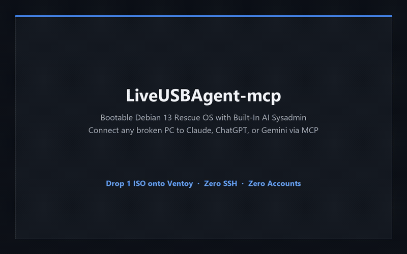
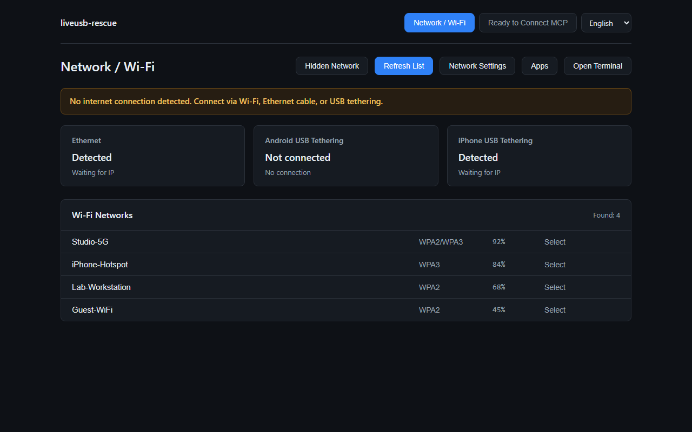
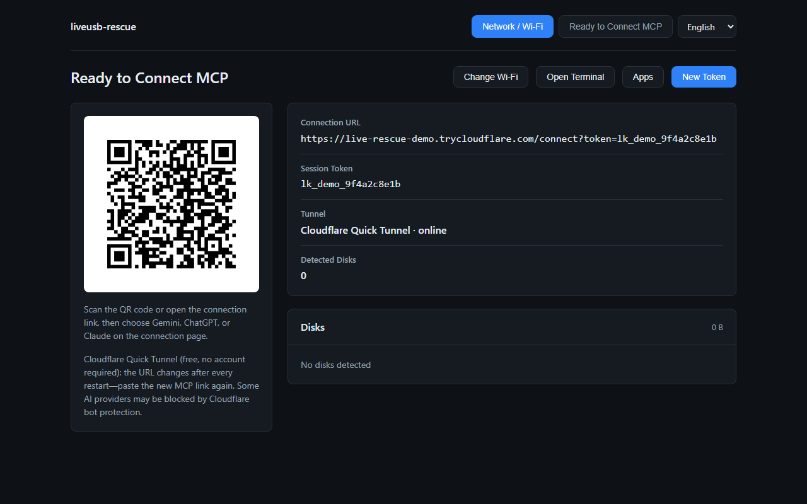
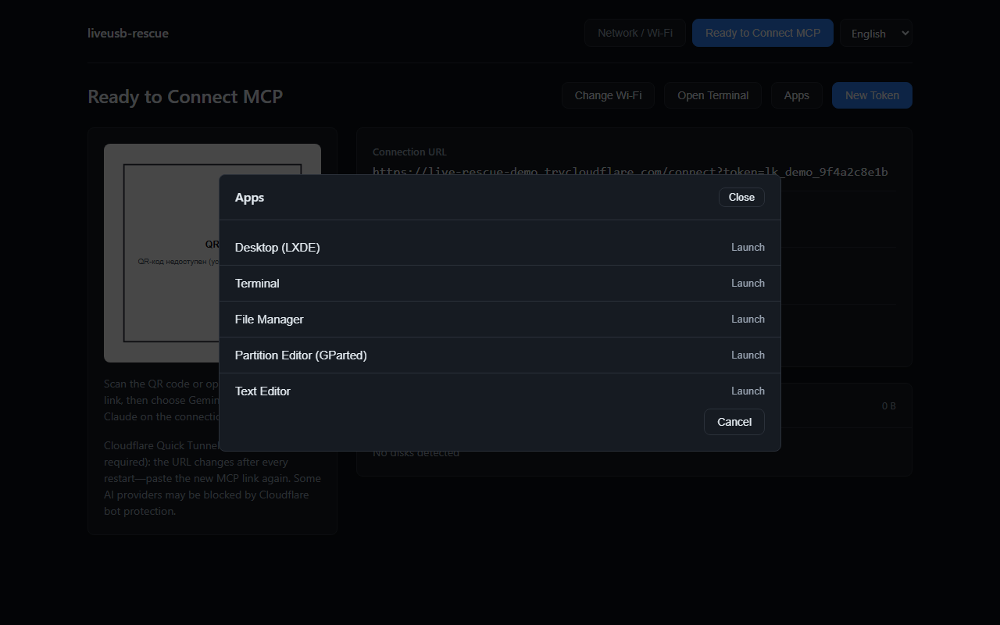
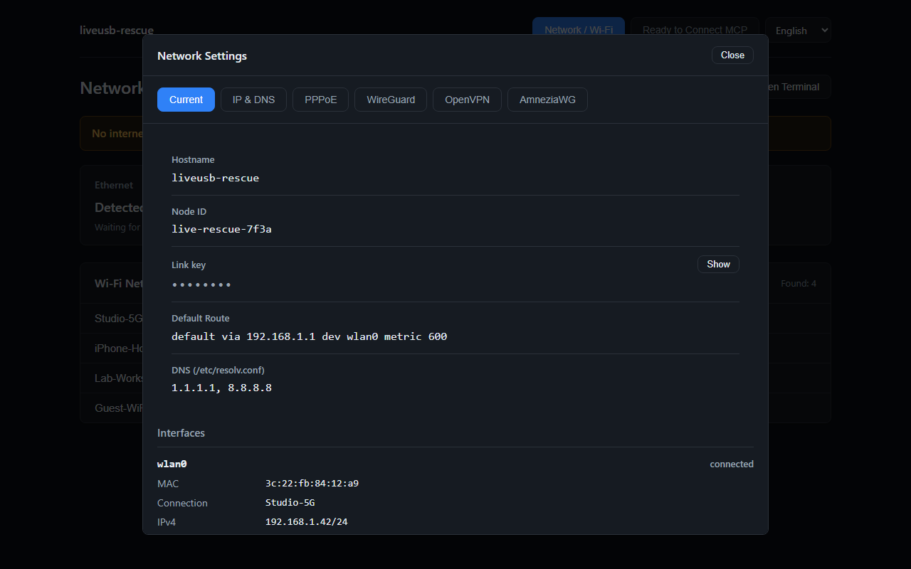
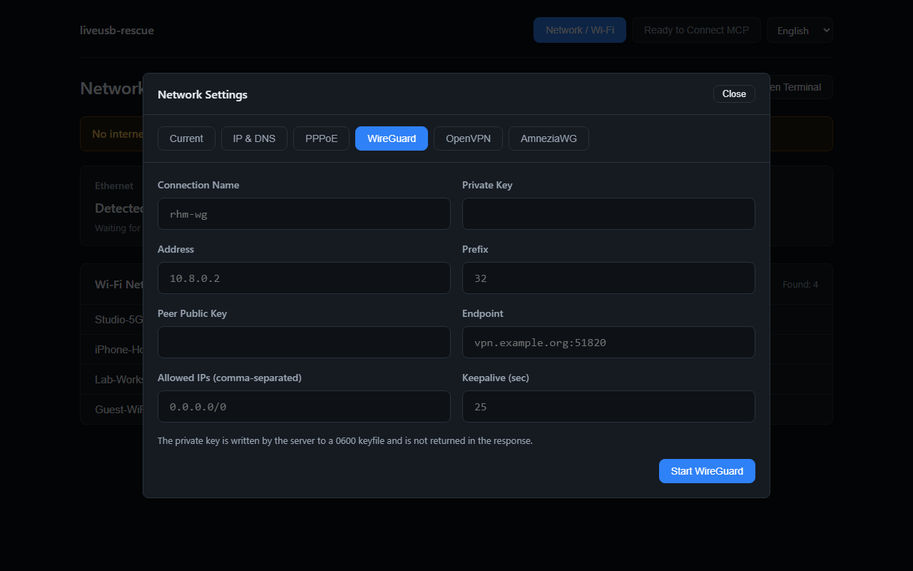
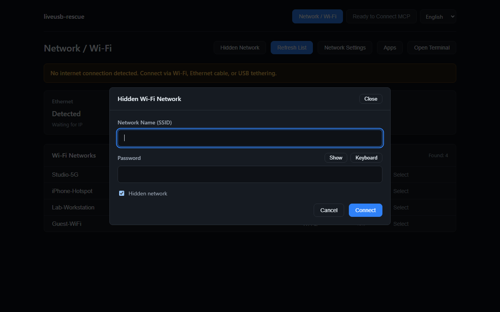

# LiveUSBAgent-mcp

> **SystemRescue / Hiren's BootCD meets MCP** — a bootable Debian 13 (Trixie) LiveUSB rescue OS that connects any broken or bare-metal PC to **Claude**, **ChatGPT**, or **Gemini** via QR code (no SSH, no accounts, no local setup).

**Version:** 0.2.1 — [Release Notes](docs/releases/v0.2.1.md) · [Русская версия (`README_RU.md`)](README_RU.md) · [Latest Release](https://github.com/LevRa7/LiveUSBAgent-mcp/releases/latest) · [Startup UI Guide](docs/liveusb/STARTUP_UI.md) · [Watch HD MP4 Demo](docs/liveusb/demo/liveusb-agent-demo.mp4)

*Standalone evolution of [remote-harness-mcp](https://github.com/LevRa7/remote-harness-mcp) built specifically for bare-metal diagnostics, offline OS repair, and data recovery.*



## Quick Start in 60 Seconds

You do not need to build anything to try **LiveUSBAgent-mcp**. Keep one hybrid ISO on your rescue stick and boot it whenever a machine refuses to start.

1. **Download the prebuilt ISO** from the [Latest GitHub Release](https://github.com/LevRa7/LiveUSBAgent-mcp/releases/latest).
   - **Architectures**: `amd64`, `arm64`, and `i386` (Debian 12 `bookworm` `686-pae` with `lite` profile).
   - **Profiles**: `full` (complete rescue toolkit + Kiosk GUI), `compact` (lightweight WebKit `surf` Kiosk + network firmware), or `lite` (minimal TUI-only image for older/low-RAM hardware).
2. **Put it on a USB drive**:
   - **Ventoy (recommended)**: drop the `.iso` directly onto your [Ventoy](https://www.ventoy.net/) partition alongside your other rescue images.
   - **Direct flash**: write with **Rufus (DD Image mode)**, **balenaEtcher**, or `dd if=liveusb-agent.iso of=/dev/sdX bs=4M status=progress oflag=sync`.
3. **Boot & get online**:
   - Boot the target machine in **UEFI** or **Legacy BIOS** mode.
   - Connect via **Ethernet**, **Wi-Fi** (including hidden SSIDs), or **iPhone / Android USB tethering** directly from the 7-language Kiosk UI.
4. **Scan the QR code & connect your AI client**:
   - Scan the on-screen QR code (opens `/connect/<token>` on your phone or laptop) and paste the single endpoint link into **Claude**, **ChatGPT**, or **Gemini**.
   - Supports **Streamable HTTP** (`/mcp/<token>`), **SSE** (`/sse?token=...`), and **OAuth 2.1 (PKCE)** out of the box.
5. **Start diagnosing with real prompts**:

```text
Inspect all attached disks and EFI partitions on this PC. Windows fails to boot with INACCESSIBLE_BOOT_DEVICE—check if BitLocker is enabled, inspect the BCD store read-only, and propose a safe offline repair plan before changing anything.
```

```text
This Linux workstation drops to an initramfs shell after a kernel update. Map the LUKS/LVM volumes, inspect /etc/fstab and GRUB config via read-only tools, and prepare a chroot repair plan.
```

```text
Check NVMe and SATA SMART health across all drives. If any disk shows pending/reallocated sectors, calculate the exact read-only ddrescue command and mapfile path to image it onto the external USB drive.
```

```text
Run a non-destructive hardware triage: inspect dmesg/journal hardware errors, thermal sensors, memory topology, and run a targeted RAM stress check without touching any internal partitions.
```

## Security TL;DR

Booting a live OS and giving an LLM access to bare-metal hardware should make any sysadmin skeptical. Here is how the blast radius is contained by default:

- **Read-only inspection first (`rescue_info`)**: All hardware, partition, SMART, filesystem, and cross-OS autorun discovery runs through strictly read-only inspection calls.
- **Dry-run by default (`rescue_action`)**: Every mutating recovery operation defaults to `dry_run=true`—the agent returns the exact command and target device/mountpoint for review before executing with `dry_run=false`.
- **RAM-only ephemeral credentials**: Session tokens live exclusively in RAM with a **24-hour TTL**, are wiped automatically on shutdown/reboot, and can be revoked instantly from the Kiosk UI using **New token**.
- **No mandatory third-party relay**: Cloudflare Quick Tunnel is zero-config for convenience, or point `--tunnel gateway` to your own self-hosted [remote-harness-mcp](https://github.com/LevRa7/remote-harness-mcp) gateway (including WireGuard, OpenVPN, PPPoE, and AmneziaWG uplinks).
- **Reproducible builds & audited skills**: Official ISOs are built transparently via Debian `live-build` in GitHub Actions, and bundled rescue skills are vetted with [NVIDIA/SkillSpector](https://github.com/NVIDIA/SkillSpector) static security scanning.

## Screenshots (English Kiosk UI)

The live environment launches straight into a clean touchscreen- and keyboard-friendly Kiosk UI on `tty1` (with a full TUI fallback on `tty2`). Key actions—**Refresh list**, **Hidden network**, **Switch Wi-Fi**, **New token**, **Network Settings**, and **Apps**—are accessible without opening a terminal. See [docs/liveusb/STARTUP_UI.md](docs/liveusb/STARTUP_UI.md) for the full UI walkthrough.

| Network & USB Tethering | Ready: QR Code & Detected Disks |
| :---: | :---: |
|  |  |
| **Local Rescue Apps Launcher** | **Network Settings — Interfaces & IDs** |
|  |  |
| **WireGuard / OpenVPN / PPPoE / AmneziaWG** | **Hidden Wi-Fi Modal** |
|  |  |

## Architecture & Key Capabilities

```text
+----------------------------------+
|  Claude / ChatGPT / Gemini       |
|  (Streamable HTTP / SSE / OAuth) |
+----------------+-----------------+
                 | HTTPS (Ephemeral Token, 24h TTL)
                 v
+----------------------------------+
|  Cloudflare Quick Tunnel         |
|  https://<random>.trycloudflare  |
|  (or self-hosted --tunnel gateway|
+----------------+-----------------+
                 | Localhost MCP Bridge (127.0.0.1:8096)
                 v
+-------------------------------------------------------------------+
|  LiveUSBAgent-mcp — Debian 13 (Trixie) LiveUSB (RAM-only)         |
|                                                                   |
|  tty1: 7-Language Kiosk UI      tty2: Full TUI Fallback           |
|  (Wi-Fi / USB Tether / QR /     (headless / low-RAM / serial)     |
|   Network Settings / Apps)                                        |
|                                                                   |
|  MCP Server: 38 Tools                                             |
|  - rescue_info (read-only)  - rescue_action (dry_run=true)        |
|  - list_skills / load_skill (progressive SKILL.md library)        |
|  - Core shell, file, search, async job & node control tools       |
+-------------------------------------------------------------------+
```

### Supported Filesystems & Storage Stacks

| Category | Filesystem / Stack | Tooling & Capabilities |
| :--- | :--- | :--- |
| **Windows / Removable** | `exFAT`, `FAT32`, `NTFS` | `ntfs3` + `ntfs-3g`, `ntfsfix`, `exfatprogs`, `dosfstools`, offline registry (`chntpw`, `libhivex-bin`) & EFI/BCD inspection |
| **Windows Encryption** | `BitLocker` | `dislocker`, `cryptsetup --type bitlk` unlock with recovery key or password |
| **Linux Native** | `ext2/3/4`, `Btrfs`, `XFS`, `F2FS` | `e2fsprogs`, `btrfs-progs`, `xfsprogs`, `f2fs-tools`, `fsck` & subvolume diagnostics |
| **Enterprise / Volumes** | `ZFS`, `LVM2`, `mdadm`, `LUKS` | `zfsutils-linux` (`zfs-dkms`), `lvm2`, `mdadm`, `cryptsetup`, `kpartx` |
| **macOS** | `HFS+`, `APFS` | `hfsplus`, `libfshfs-utils`, `apfs-dkms`, `apfs-fuse` (FileVault R/O), `libfsapfs-utils` |

### Built for Real-World Field Recovery

- **7-language Kiosk UI**: Instant switching between English, German, Russian, French, Spanish, Arabic (RTL), and Chinese—ideal for helping family or clients remotely over a phone camera.
- **Zero-drama connectivity**: Plug in an **iPhone** (`usbmuxd` / `ipheth` / `libimobiledevice-utils`) or **Android** phone (`rndis_host` / `cdc_ether` / `cdc_ncm`) via USB tethering when Wi-Fi drivers or routers are unavailable, or configure **WireGuard**, **OpenVPN**, **PPPoE**, and **AmneziaWG** inside **Network Settings**.
- **Broad Wi-Fi hardware support**: Ships Debian `non-free-firmware` plus `broadcom-sta-dkms` for stubborn laptop and MacBook wireless adapters, with **Refresh list**, **Hidden network**, and **Switch Wi-Fi** controls right on screen.
- **Progressive `SKILL.md` rescue library**: Keeps the LLM context window lean by loading domain runbooks only when needed via `list_skills` and `load_skill`:
  - `windows-offline-boot-repair`
  - `linux-chroot-grub-luks-rescue`
  - `macos-apfs-hfs-recovery`
  - `ram-hardware-live-diagnostics`

## Available MCP Tools & Concrete Rescue Use Cases

**LiveUSBAgent-mcp** exposes **38 MCP tools** structured around safe inspection, guarded action, and progressive skill loading.

### Rescue & Skill Tools

| Tool | Mode | Purpose |
| :--- | :--- | :--- |
| `rescue_info` | Read-only | Inspect block devices, GPT/MBR tables, EFI entries, SMART health, filesystems (NTFS/BitLocker/LUKS/LVM/ZFS/APFS), boot logs, RAM/DIMMs, and cross-OS autoruns. |
| `rescue_action` | Guarded (`dry_run=true` default) | Execute structured recovery operations (`mount_safe`, `mount_auto`, `umount`, `fsck_check`, `ntfs_fix`, `grub_repair`, `win_sam_reset`, `ddrescue_plan`, `chroot_exec`, `ram_test_plan`, `ram_dump_plan`) with preview before commit. |
| `list_skills` | Read-only | Enumerate installed `SKILL.md` rescue runbooks and metadata without bloating model context. |
| `load_skill` | Read-only | Load the full step-by-step instructions, safety checks, and reference files for a specific rescue scenario. |

### Core System, File & Job Tools

| Tool Group | Tools | What It Enables |
| :--- | :--- | :--- |
| **Mesh & Telemetry** | `mesh_status`, `system_info`, `system_vitals` | Verify uplink status, active tunnel, CPU/RAM/thermal vitals, and attached hardware topology. |
| **Shell Execution** | `bash_exec` | Run ad-hoc Linux diagnostic utilities (`smartctl`, `nvme`, `dmidecode`, `efibootmgr`, `journalctl`, `memtester`). |
| **File Operations** | `read_file`, `write_file`, `edit_file` | Inspect and patch `/etc/fstab`, GRUB configs, systemd units, or Windows/Linux boot logs on mounted targets. |
| **Filesystem Search** | `list_dir`, `glob_find`, `grep_search` | Locate crash dumps, kernel logs, EFI binaries, or corrupted configuration files across mounted volumes. |
| **Async Long Jobs** | `run_job`, `job_output`, `job_list`, `job_kill` | Run long-running `ddrescue`, `badblocks`, `testdisk`, or `memtester` sessions in the background and stream progress without tool timeouts. |
| **Node Lifecycle** | `node_control` | Controlled access mode adjustments, working directory changes, or pause/resume once recovery is complete. |

## Security Model & Safety Guardrails

1. **Clear Trust Boundary**:
   - The LiveUSB OS runs in RAM (`toram` default on >= 4 GB RAM) and never auto-mounts internal target partitions read-write.
   - `rescue_info` is strictly read-only. Every state-changing step in `rescue_action` defaults to `dry_run=true` so you can verify target block devices (`/dev/nvme0n1p2` vs `/dev/sda1`) before approving `dry_run=false`.
   - Physical/screen possession of the QR code and `lk_...` token is the trust boundary—treat the pairing URL like a temporary root password and never share live Kiosk QR screenshots publicly.
   - An active uplink lock prevents accidental disconnection of the network interface carrying your live MCP tunnel while troubleshooting other NICs.
2. **Ephemeral Credentials & Instant Revocation**:
   - On boot, the agent generates a cryptographically random session token stored only in RAM (`/run/rhm-live/`, mode `0600`) with a **24-hour TTL**.
   - Clicking **New token** in the Kiosk UI or performing a clean shutdown/reboot revokes the active session immediately. Powering off erases all RAM-only state.
3. **Secure Boot & Unsigned DKMS Modules**:
   - The image includes `shim-signed` and Debian's signed kernel, so basic boot works with Secure Boot enabled. However, optional out-of-tree DKMS drivers (`apfs-dkms`, `broadcom-sta-dkms`, `zfs`) are unsigned—disable Secure Boot in UEFI/BIOS (or enroll a MOK key) if you need APFS, Broadcom STA, or ZFS kernel modules.
4. **Cloudflare Quick Tunnel Caveat & Self-Hosted Fallback**:
   - By default, `--tunnel cloudflare` creates an instant `*.trycloudflare.com` endpoint with zero accounts. Occasionally, Cloudflare edge bot-protection or corporate firewalls may challenge or block `trycloudflare.com` requests from certain AI client backends.
   - For corporate networks, strict privacy policies, or guaranteed uptime, switch to `--tunnel gateway` (or bake `--gateway <host>` into your custom ISO) to route exclusively through your own self-hosted [remote-harness-mcp](https://github.com/LevRa7/remote-harness-mcp) server.

## Build from Source & Test in QEMU

Every official release ISO is reproducible using Debian `live-build`. You can customize profiles, architectures, bundled skills, or a preconfigured self-hosted gateway.

### Build a Custom ISO (`ops/live-usb/build-iso.sh`)

```bash
sudo apt-get update
sudo apt-get install -y \
  live-build debootstrap squashfs-tools xorriso \
  grub-efi-amd64-bin grub-pc-bin mtools dosfstools \
  curl jq git ca-certificates

git clone https://github.com/LevRa7/LiveUSBAgent-mcp.git
cd LiveUSBAgent-mcp

# Full amd64 ISO with curated external rescue skills
sudo ./ops/live-usb/build-iso.sh --with-external-skills --build
```

Common `build-iso.sh` options:

```bash
# Compact WebKit Kiosk image (smaller footprint, network firmware included)
sudo ./ops/live-usb/build-iso.sh --profile compact --arch amd64 --build

# Minimal TUI-only image for legacy 32-bit x86 machines (Debian 12 bookworm 686-pae)
sudo ./ops/live-usb/build-iso.sh --profile lite --arch i386 --build

# ARM64 build with custom work directory and preconfigured self-hosted gateway
sudo ./ops/live-usb/build-iso.sh \
  --profile full \
  --arch arm64 \
  --work-dir /var/tmp/rhm-live-build \
  --gateway your-gateway.example.com \
  --build
```

### Boot & Test Locally in QEMU (`ops/live-usb/test-qemu.sh`)

Validate boot flow, Kiosk UI, and multi-filesystem recovery against synthetic test disks without touching real hardware:

```bash
# UEFI boot with auto-generated test disks (exFAT, FAT32, NTFS, ext4, Btrfs, XFS)
./ops/live-usb/test-qemu.sh --mode uefi --create-fs-disks

# Legacy BIOS boot with 2 GB RAM (great for verifying compact/lite profiles)
./ops/live-usb/test-qemu.sh --mode bios --ram 2048

# Headless serial console test for CI or SSH-only dev boxes
./ops/live-usb/test-qemu.sh --mode uefi --headless --create-fs-disks
```

## Contributing & License

Issues, pull requests, new `SKILL.md` rescue runbooks, and hardware compatibility reports are welcome on [GitHub](https://github.com/LevRa7/LiveUSBAgent-mcp). If you also want an always-on MCP agent for running Windows, Linux, macOS, or Android (Termux) machines, check out the sibling project [remote-harness-mcp](https://github.com/LevRa7/remote-harness-mcp).
