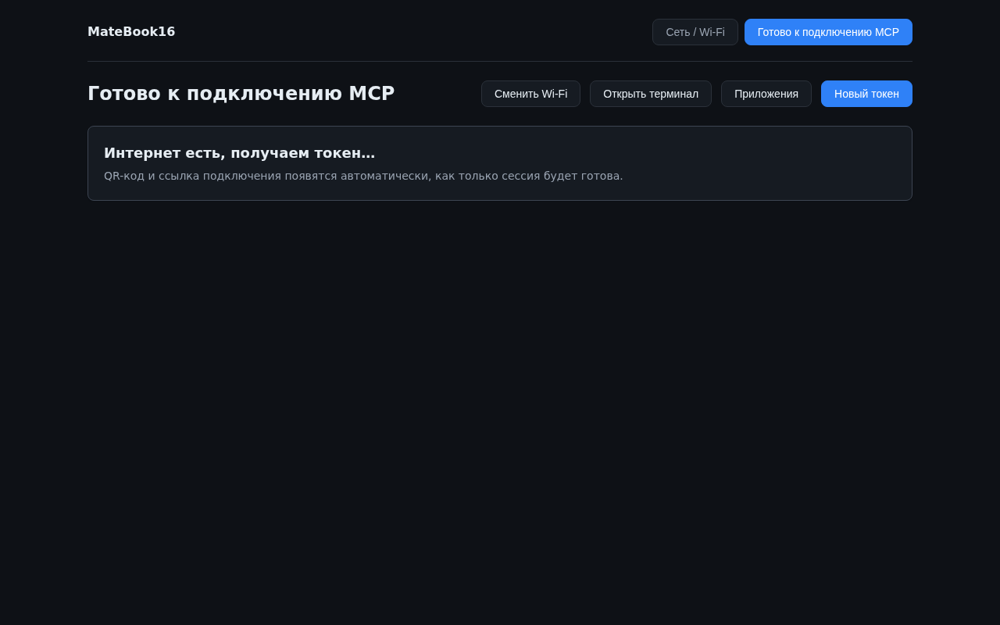
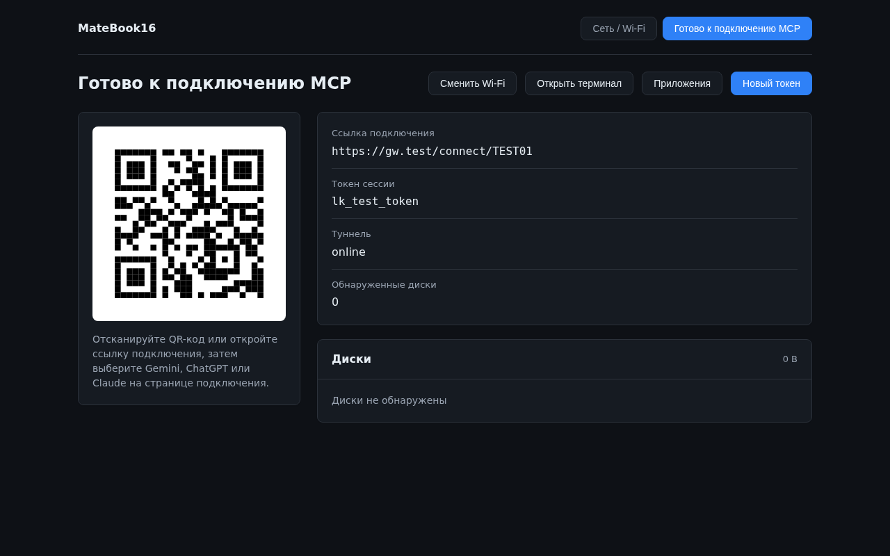
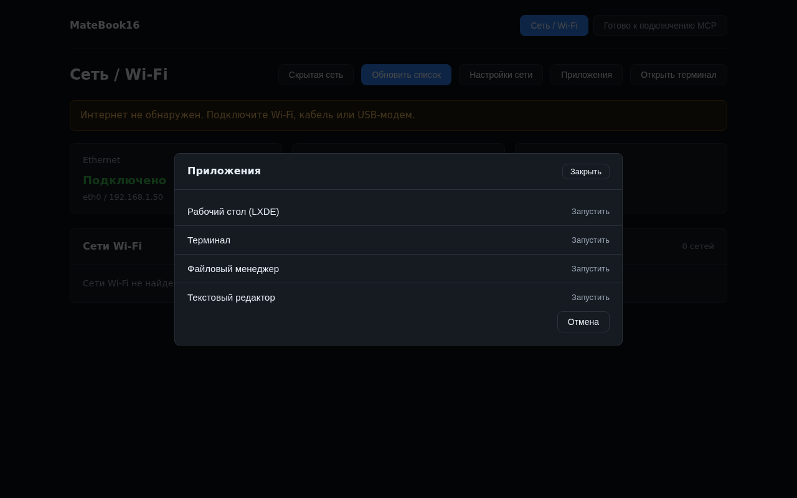
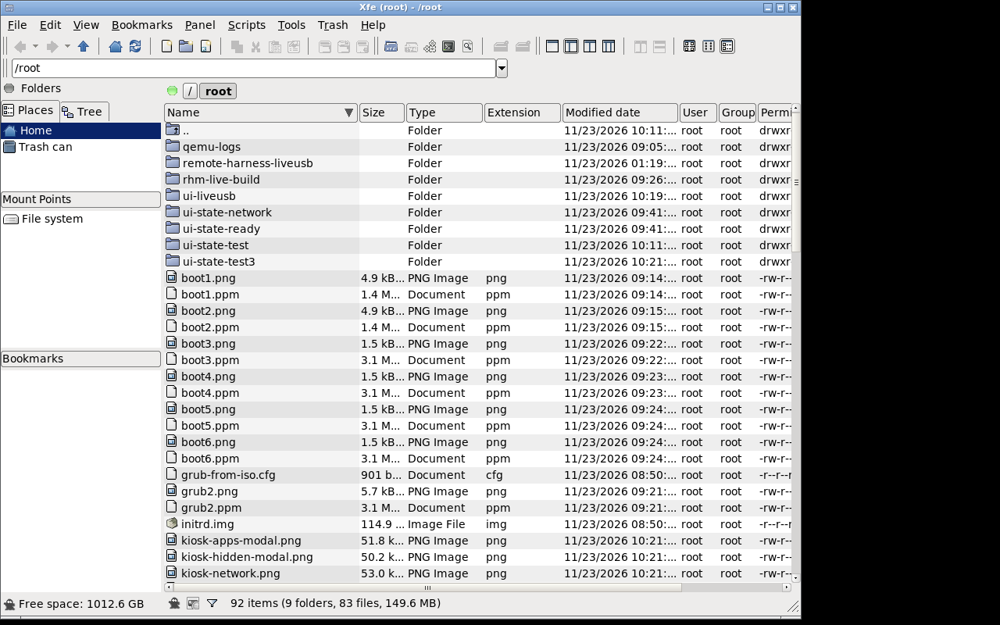
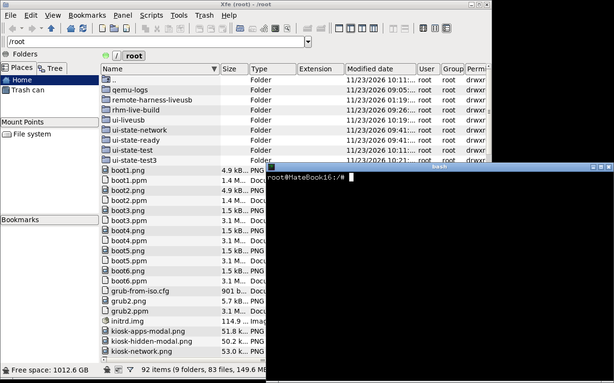
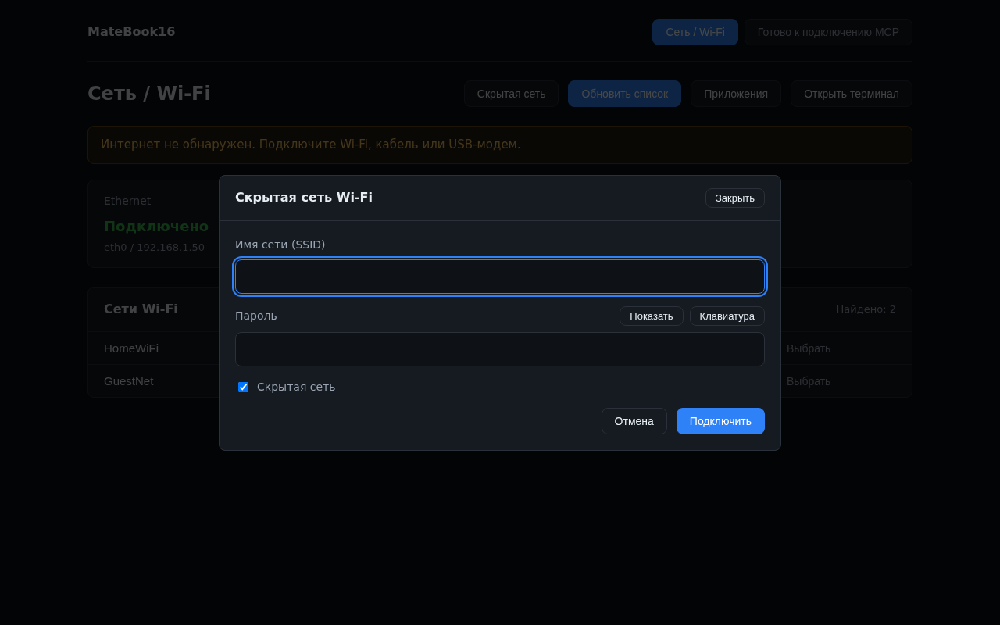
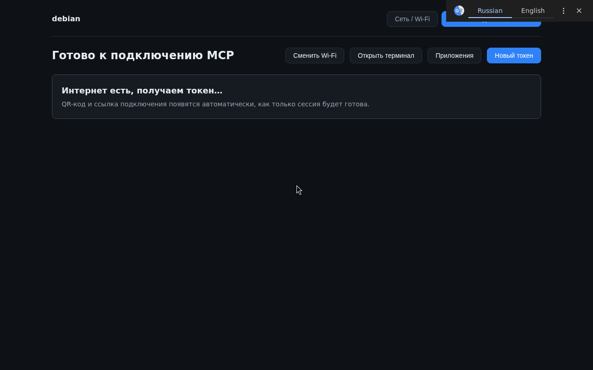

# Kiosk startup screens and local apps

The kiosk always starts on the **network** view, but the view is driven by
internet reachability, not by the Ethernet link state alone.

## 1. Link is up, internet is not: network view

- The amber banner says **«Интернет не обнаружен. Подключите Wi-Fi, кабель или
  USB-модем.»** — this is the answer to “Ethernet shows connected, why no QR?”:
  the card reports the link, the banner reports internet.
- The screen shows Ethernet, Android USB tethering, iPhone USB tethering, a
  Wi-Fi scan list, hidden-network entry, rescan, «Приложения» and «Открыть
  терминал».
- `app.js` calls `fetchStatus()` and `scanWifi()` on startup and polls
  `/api/status` every 3 seconds.

## 2. Internet is up, session is still being registered: pending view

`applyAutoView()` switches to the ready view as soon as
`internet.reachable=true`, even before `session.ready`. The pending card says
**«Интернет есть, получаем токен…»** and explains that the QR and connect URL
appear automatically. The QR/URL/token block is hidden until the session is
ready; the app, terminal, change-Wi-Fi and new-token controls remain available.

## 3. Internet and session are ready: QR view

- The QR encodes `https://<gateway>/connect/<session_code>`.
- The connect URL and the `lk_…` token are shown under it.
- The instruction says: scan the QR or open the link, then choose
  Gemini/ChatGPT/Claude on the connect page.
- The view also has «Сменить Wi-Fi», «Открыть терминал», «Приложения» and
  «Новый токен».

If the operator explicitly chooses «Сеть / Wi-Fi», the automatic switch is
suppressed; polling still refreshes the data.

## 4. Local applications

«Приложения» opens an allowlisted launcher backed by
`GET /api/apps` and `POST /api/apps/launch`:

- **Терминал** — `xterm -e bash` (or the configured terminal emulator).
- **Файловый менеджер** — `rhm-open-files`, a wrapper around `xfe` that opens
  `/mnt/rescue` (fallback `/root`) and dismisses Xfe's root warning
  automatically. `pcmanfm` remains a fallback if `xfe` is absent.
- **Текстовый редактор** — `mousepad`.

The backend accepts only `{"id": "..."}` from the browser and chooses the argv
from a fixed allowlist; it never accepts a command or path. The terminal button
on both views uses `POST /api/terminal`, which resolves the same allowlisted
`terminal` entry.

The hidden-Wi-Fi dialog is unchanged:

All screenshots above were rendered from the real
`ops/live-usb/kiosk_ui/` files in Chromium 156 at 1280×800, with the real
kiosk HTTP server and a mocked `/api/status`. The file-manager and terminal
screenshots are Xvfb captures of the actual launched windows. `/root` appears
because the UI harness does not create `/mnt/rescue`; the ISO's
`start-kiosk.sh` creates that directory before the server starts.

## 5. The same UI on the built ISO

The final ISO was booted in QEMU UEFI (TCG) after the
`rhm-live-kiosk.service` fix. The kiosk service starts Chromium on `tty1` and
the real UI appears (the screenshot shows the pending session because the QEMU
network has no reachable gateway to register with). The service owns `tty1`
and masks `getty@tty1`, so live-config's default user can no longer park the
image at a login prompt.

