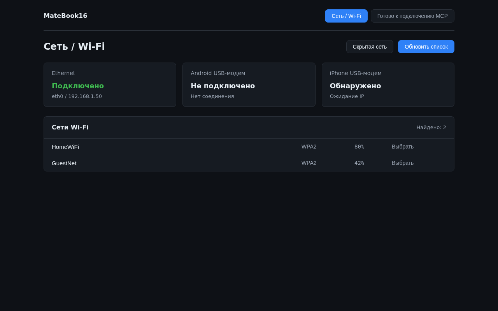

# Kiosk startup screens

The kiosk always starts on the **network** view. It switches to the **ready**
view only after the node has registered an ephemeral session with the gateway,
because the QR code and token do not exist before that.

## No internet / no session: network view

- `index.html` ships `view-network` without `is-hidden` and `view-ready` with
  `is-hidden`.
- `app.js` calls `fetchStatus()` and `scanWifi()` on startup, then polls
  `/api/status` every 3 seconds.
- The screen shows Ethernet, Android USB tethering, iPhone USB tethering, a
  Wi-Fi list, hidden-network entry and a rescan button.
- Staying here is correct while `session.ready` is false — including the case
  where internet exists but gateway registration has not finished yet.

## Internet + registered session: QR view

- When `/api/status` reports a ready session, `app.js` calls
  `setView("ready", false)` unless the operator explicitly chose the network
  view.
- The ready view contains the SVG QR (`/api/qr.svg`) built from
  `connect_url`, the short connect URL, the `lk_…` session token, tunnel state,
  detected disks, «Сменить Wi-Fi», «Открыть терминал» and «Новый токен».
- The QR points at `/connect/<session_code>` on the gateway; the token is the
  same `lk_…` shown under the QR.

Both screenshots were rendered from the real `ops/live-usb/kiosk_ui/` files in
Chromium 156 at 1280×800, with the kiosk HTTP server and a mocked
`/api/status` (first: `internet.reachable=false`, no `session.json`; second:
`reachable=true` and a ready `session.json`). They are UI proofs, not captures
of a physical screen; the headless QEMU framebuffer stayed black after GRUB.
