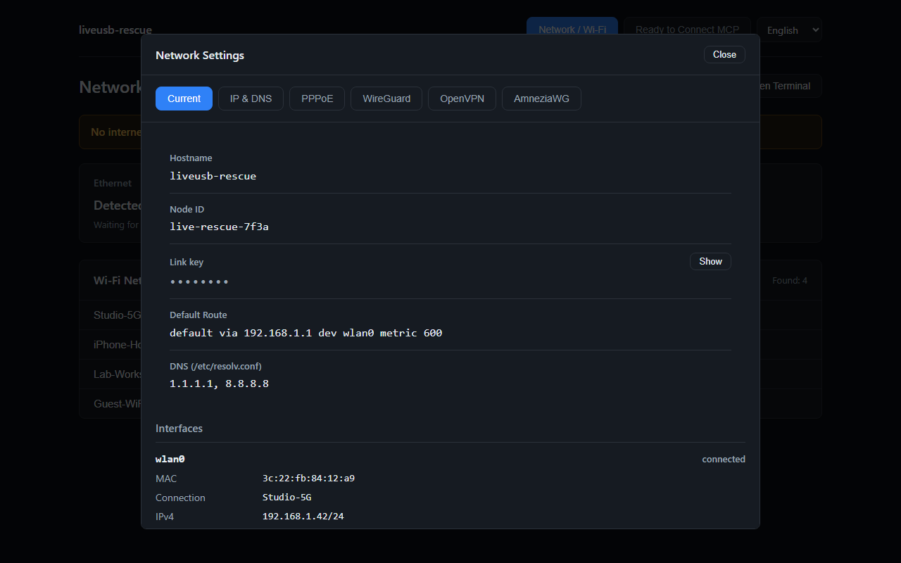

# Kiosk startup screens and local apps

The kiosk always starts on the **network** view, but the view is driven by
internet reachability, not by the Ethernet link state alone.

## 1. Link is up, internet is not: network view

- The amber banner says **Internet is not reachable. Connect Wi-Fi, cable or USB tethering.** — this is the answer to “Ethernet shows connected, why no QR?”:
  the card reports the link, the banner reports internet.
- The screen shows Ethernet, Android USB tethering, iPhone USB tethering, a
  Wi-Fi scan list, hidden-network entry, rescan, **Applications** and **Open terminal**.
- `app.js` calls `fetchStatus()` and `scanWifi()` on startup and polls
  `/api/status` every 3 seconds.

## 2. Internet is up, session is still being registered: pending view

`applyAutoView()` switches to the ready view as soon as
`internet.reachable=true`, even before `session.ready`. The pending card says
**Internet is up, getting token...** and explains that the QR and connect URL
appear automatically. The QR/URL/token block is hidden until the session is
ready; the app, terminal, change-Wi-Fi and new-token controls remain available.

## 3. Internet and session are ready: QR view

- The QR encodes `https://<gateway>/connect/<session_code>`.
- The connect URL and the `lk_…` token are shown under it.
- The instruction says: scan the QR or open the link, then choose
  Gemini/ChatGPT/Claude on the connect page.
- The view also has **Network / Wi-Fi**, **Open terminal**, **Applications** and
  **New token**.

If the operator explicitly chooses **Network / Wi-Fi**, the automatic switch is
suppressed; polling still refreshes the data.

## 4. Local applications

**Applications** opens an allowlisted launcher backed by
`GET /api/apps` and `POST /api/apps/launch`:

- **Desktop (LXDE)** — starts a full LXDE session on `:1`/`vt2` via
  `rhm-open-desktop`; it has the LXDE Start menu, PCManFM, terminal, display
  (`lxrandr`), keyboard/mouse (`lxinput`) and appearance (`lxappearance`)
  settings. The kiosk stays on `vt1`; `Ctrl+Alt+F1` returns to it.
- **Terminal** — `xterm -e bash` (or the configured terminal emulator).
- **File Manager** — `rhm-open-files`, a wrapper around `xfe` that opens
  `/mnt/rescue` (fallback `/root`) and dismisses Xfe's root warning
  automatically. `pcmanfm` remains a fallback if `xfe` is absent.
- **Text Editor** — `mousepad`.

The backend accepts only `{"id": "..."}` from the browser and chooses the argv
from a fixed allowlist; it never accepts a command or path. The terminal button
on both views uses `POST /api/terminal`, which resolves the same allowlisted
`terminal` entry.

The hidden-Wi-Fi dialog is unchanged:

All screenshots above were rendered from the real
`ops/live-usb/kiosk_ui/` files in Chromium 156 at 1280×800, with the real
kiosk HTTP server and a mocked `/api/status`. The file-manager and terminal
screenshots are Xvfb captures of the actual launched windows. `/root` appears
because the UI harness does not create `/mnt/rescue`; the ISO's
`start-kiosk.sh` creates that directory before the server starts.

## 6. Network settings

The network view has **Network Settings** with five tabs:

- **Current** — hostname, node ID, link key (masked, **Show/Hide**),
  default route, `/etc/resolv.conf` DNS and every interface (name, MAC, state,
  NetworkManager connection, IPv4, gateway, DNS).
- **IP & DNS** — DHCP or static IPv4/prefix/gateway/DNS for the selected
  interface, applied through `nmcli con mod` + `nmcli con up`.
- **PPPoE** — username, password, optional service; creates and activates the
  `rhm-pppoe` NetworkManager connection.
- **WireGuard** — name, private key, address/prefix, peer key, endpoint,
  allowed IPs and keepalive; writes a `0600` NetworkManager keyfile.
- **OpenVPN** — paste a `.ovpn`; imports it through NetworkManager.

Passwords/private keys are never rendered after submit, never written to
`console`, and the backend returns `redacted: true` instead of echoing them.
The ISO ships `ppp`, `wireguard-tools`, `openvpn` and
`network-manager-openvpn`, and `build-iso.sh --check` pins all four.

The default public domain is now
`racknerd-5a24bf9.merino-carob.ts.net` — the old domain is gone from the
active code, docs and tests.

## 7. AmneziaWG and subscriptions

The **AmneziaWG** tab accepts the AmneziaWG INI (`Jc/Jmin/Jmax/S1/S2/H1-H4`),
shows `awg show` status, starts/stops through `awg-quick`, and imports a
subscription URL over HTTPS. A plain config or base64/base64url-encoded config
is accepted; the subscription URL is also rendered as a QR that a phone can
scan. Private and preshared keys are never returned or rendered.

The ISO builds `awg`/`awg-quick` and the unsigned AmneziaWG kernel module in
the chroot hook (warns and continues if a source build fails). Secure Boot must
be off for the module.

## 8. The same UI on the built ISO

The final ISO was booted in QEMU UEFI (TCG) after the
`rhm-live-kiosk.service` fix. The kiosk service starts Chromium on `tty1` and
the real UI appears (the screenshot shows the pending session because the QEMU
network has no reachable gateway to register with). The service owns `tty1`
and masks `getty@tty1`, so live-config's default user can no longer park the
image at a login prompt.
